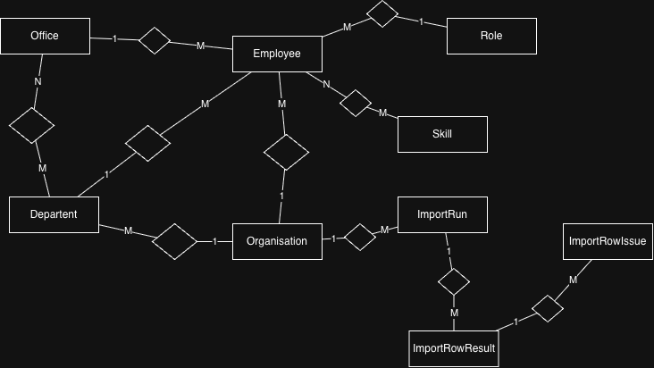

# Employee Data Importer API

A .NET 10 Web API that imports employee data for two organisations from Excel and CSV files into a PostgreSQL database. For every row it decides whether to import it fully, partially or not at all, and it reports the outcome. It also exposes statistics and reports on the imported data.

| Organisation | Source |
| --- | --- |
| Shelby Limited Co. | One Excel workbook (`.xlsx`) with an Employees sheet and a Skills sheet |
| Dunder Mifflin Paper Co. | Two CSV files (`.csv`), one for employees and one for skills |

Data Files: 
https://drive.google.com/drive/folders/1PtB-f_bD4I84C8xLyBm1U7r8m3o1eYzF?usp=drive_link

---

## Contents

1. [Tech stack](#1-tech-stack)
2. [Getting started](#2-getting-started)
3. [Database model](#3-database-model)
4. [Input files](#4-input-files)
5. [Validation rules](#5-validation-rules)
6. [Judgement calls](#6-judgement-calls)
7. [API endpoints](#7-api-endpoints)
---

## 1. Tech stack

- .NET 10, ASP.NET Core controllers
- Entity Framework Core with PostgreSQL (Npgsql), schema created only through migrations
- ClosedXML for reading and writing Excel files
- CsvHelper for reading CSV files
- MagicBytesValidator for checking the real content of uploaded `.xlsx` files

Solution layout:

| Project | Purpose |
| --- | --- |
| `EmployeeDataImporterApi` | Controllers, middleware, startup |
| `EmployeeDataImporterApi.Services` | Readers, validators, import service, statistics queries, Excel export |
| `EmployeeDataImporterApi.Domain` | Entities, DTOs, enums, helpers |

---

## 2. Getting started

### Requirements

- .NET 10 SDK
- PostgreSQL

### Configure

Set the connection string in `appsettings.Development.json` (or with user secrets):

```json
{
  "ConnectionStrings": {
    "DefaultConnection": "Host=localhost;Port=5432;Database=YOUR_DB_NAME;Username=YOUR_USERNAME;Password=YOUR_PASSWORD"
  }
}
```

### Create the database

The database is created only through migrations, and the seed data comes with them:

```bash
dotnet ef database update --project EmployeeDataImporterApi.Domain --startup-project EmployeeDataImporterApi
```

Adjust the `--project` value to the project that contains the migrations.

### Run

```bash
dotnet run --project EmployeeDataImporterApi
```

The API listens on `http://localhost:5007` in development.

---

## 3. Database model



Every entity derives from `BaseEntity` (`Guid Id`, `IsDeleted`, `CreatedAt`, `UpdatedAt`).

- **Soft delete.** Nothing is physically removed. A global query filter (`!IsDeleted`) is applied to all `BaseEntity` types in one place, and `SaveChanges` converts a delete into `IsDeleted = true`. The same override sets `CreatedAt` and `UpdatedAt`.
- **Natural key.** `EmployeeNumber` is unique per organisation and is used for lookups and duplicate checks. It never replaces the `Guid` Id.
- **Unique indexes** on `(OrganisationId, EmployeeNumber)` and `Email` are filtered so that soft-deleted rows are ignored.
- **Employee → Manager** is an optional self-reference without cascade delete.
- **Employee ↔ Skill** is many-to-many through `EmployeeSkill`.

### Seeded data (`HasData`, hard-coded Guids)

| Entity | Content |
| --- | --- |
| Organisation | Shelby Limited Co., Dunder Mifflin Paper Co. |
| Department | At least 4 per organisation, each with a short `Code` |
| Office | At least 2 per organisation |
| Role | Base job titles such as Associate, Manager, Team Lead |
| Skill | Shared catalogue of skill names |

### Created by the importer

| Entity | Content |
| --- | --- |
| Employee | Imported people |
| EmployeeSkill | Links between employees and skills |
| ImportRun | One execution of an import: file names, organisation, start and end time, totals, message |
| ImportRowResult | Outcome of one row: row number, `EmployeeNumber`, status, file type |
| ImportRowIssue | One problem of one row: field, error code, message, original value |

---

## 4. Input files

### Accepted files

- Only `.xlsx` and `.csv`.
- A request may contain several files, but they must all have the same type (all `.xlsx` or all `.csv`).
- The content is checked, not just the extension: `.xlsx` files are checked by their magic bytes, and a `.csv` must be UTF-8 text (files with binary content are rejected).
- Header names are matched case-insensitively, extra columns are ignored, and empty trailing rows are skipped.
- Excel dates stored as dates or as numbers are converted to `yyyy-MM-dd` before validation.
- All rows are first read as text (`string?`) together with their original row number, and are only validated afterwards.
- The reader is chosen by file extension. An unsupported extension gives a clear error.

### Employees file

All columns must exist in the header, but values may be empty, and the table in section 5 says what each missing value does.

| Column | Required value |
| --- | --- |
| EmployeeNumber | yes |
| FirstName | yes |
| LastName | yes |
| Email | yes |
| DateOfBirth | no |
| HireDate | yes |
| DepartmentCode | yes |
| RoleTitle | yes |
| OfficeCity | no |
| Salary | no |
| Phone | no |
| ManagerEmployeeNumber | no |
| Notes | no |

A missing required header stops the import of that file and is reported in the run message.

### Skills file

Required headers: `EmployeeNumber`, `FirstName`, `LastName`, `DateOfBirth`, `SkillName`. Rows never contain database Ids.

---

## 5. Validation rules

### Normalisation (never an error)

Whitespace is trimmed and repeated spaces are collapsed. Emails are lower-cased. Department codes, office cities, role titles and skill names are matched case-insensitively. Names with diacritics (Müller, Šimić) are valid and are not altered.

### Classification

A row is **Skipped** if any required field fails, **Partial** if only optional fields fail, and **Imported** if nothing fails. Every row ends with exactly one status, and a row with several problems records all of them. Imported and Partial rows are saved, Skipped rows are not, but all of them appear in the report.

| Field | Required | If missing or invalid |
| --- | --- | --- |
| EmployeeNumber | yes | Skip |
| FirstName, LastName | yes | Skip |
| Email | yes (valid format) | Skip |
| DepartmentCode | yes (must exist in the organisation) | Skip |
| RoleTitle | yes (must match a seeded role) | Skip |
| HireDate | yes (valid date, not in the future) | Skip |
| DateOfBirth | no | Set to null, Partial (also if the person would be under 16) |
| Salary | no | Set to null, Partial (also if zero or negative) |
| Phone | no | Set to null, Partial |
| OfficeCity | no | Set to null, Partial (city must exist in the organisation) |
| ManagerEmployeeNumber | no | Manager link left empty, Partial |
| Skills | no | The skill is dropped, the employee becomes Partial |

Messy but valid data is not an error: extra spaces, wrong letter case and diacritics are normalised and imported without a warning.

### Duplicates

The first occurrence of an `EmployeeNumber` or `Email` within a file wins, and every later one is Skipped with `DuplicateEmployeeNumber` or `DuplicateEmail`. A row whose `EmployeeNumber` already exists in the database for that organisation is also Skipped. Emails are unique across all organisations.

### Accepted date formats

| Pattern | Example |
| --- | --- |
| `yyyy-MM-dd`, `yyyy/MM/dd`, `yyyy.MM.dd` | 2024-01-15 |
| `dd-MM-yyyy`, `dd/MM/yyyy`, `dd.MM.yyyy` | 15.01.2024 |

- Day and month may have one or two digits.
- When the year comes last, the first number is the **day** (day-month-year), as it is commonly written in Europe. A date like `03/25/2024` is therefore invalid.
- The year must have four digits. Two-digit years are rejected, because the century would be a guess.
- Impossible dates (`31.02.2024`) are invalid.
- Values are parsed with the invariant culture, so the result does not depend on the machine.

### Error codes

TODO: verify this list against the `IssueType` enum.

| Code | Field | Effect | When |
| --- | --- | --- | --- |
| MissingRequiredField | any required field | Skipped | A required value is empty |
| DuplicateEmployeeNumber | EmployeeNumber | Skipped | Number already taken in the file or in the database |
| EmailInvalid | Email | Skipped | Not a valid address |
| DuplicateEmail | Email | Skipped | Email already taken |
| DepartmentUnknown | DepartmentCode | Skipped | Code not found in the organisation |
| RoleUnknown | RoleTitle | Skipped | Title does not match a seeded role |
| HireDateInvalid | HireDate | Skipped | Not a valid date |
| HireDateInFuture | HireDate | Skipped | After today |
| DateOfBirthInvalid | DateOfBirth | Partial | Not a valid date |
| DateOfBirthTooYoung | DateOfBirth | Partial | Person would be under 16 |
| SalaryInvalid | Salary | Partial | Not a number, or zero or negative |
| PhoneInvalid | Phone | Partial | Fails the phone rule |
| OfficeUnknown | OfficeCity | Partial | No office in that city |
| ManagerUnknown | ManagerEmployeeNumber | Partial | Manager does not match a saved employee |
| ManagerCycle | ManagerEmployeeNumber | Skipped | The row is part of a manager cycle |
| MissingSkillNameField | SkillName | Skill row not saved | Skill name is empty |
| InvalidSkillName | SkillName | Skill row not saved, employee Partial | Skill not in the catalogue |
| InvalidEmployeeNumber / not found | EmployeeNumber | Skill row not saved | No employee with this number or name and date of birth |
| SkillEmployeeAmbiguous | FirstName, LastName, DateOfBirth | Skill row not saved | More than one employee matches |
| DuplicateSkillEmployeeNumber | – | Skill row not saved | The employee already has this skill |

---

## 6. Judgement calls

These are the places where the task left the decision open, with the choice made and the reason.

**Optional fields**

- An **empty** optional value is not an issue (a top-level employee legitimately has no manager). Only a value that is present and invalid makes the row Partial.
- "Under 16" is measured against today's date, not against the hire date.
- **Salary:** every character except digits and `.` is removed before parsing, so a currency symbol and thousands separators like `$` or `,` are accepted. A comma used as the decimal mark (`55000,50`) would therefore be misread, and this is a known limitation.
- **Phone:** only digits, spaces and `+ ( ) . -` are allowed, with 7 to 15 digits.

**Roles**

- The file title is split into a level word and a base role. `Junior` and `Senior` map to the levels 1 and 3, and the base title (`Associate`, `Manager`, ...) is matched to a seeded role. A title without a level word gets the default level `Mid`.

- A title that matches no seeded role is Skipped (`RoleUnknown`).

**Duplicates**

- Only rows that are going to be saved reserve their number and email. If a first row is skipped for another reason, a later row with the same number is not a duplicate.

**Managers**

- A manager may appear later in the file than their employee, because managers are linked after all rows have been validated.
- A manager must be in the **same file**. A manager number that matches no saved employee leaves the manager empty and makes the row Partial.
- **Cycles.** Following the manager links from every employee, any chain that returns to an employee already on the current path is a cycle. All employees **in** the cycle are Skipped with `ManagerCycle`. Employees that only lead into a cycle are not skipped, but they lose their manager link and become Partial. A self-reference (A manages A) is a cycle of length one.

**Skills**

- A skill row is matched against **all employees of the organisation**: those already in the database and those imported in the same run. An employee who has worked there for years can learn a new skill.
- If `EmployeeNumber` is filled in, it is used for the lookup, and the name and date of birth are not compared. If it is empty, the row is matched on first name, last name and date of birth together, and all three must be present and valid.
- No match, more than one match, or missing identity: the row is reported and not saved. The importer never guesses.
- A skill row for an employee who was skipped is reported and not saved.
- Skill names are matched against the seeded catalogue, case-insensitively. An unknown skill is dropped.
- If the employee already has the skill, the row is reported as a duplicate and nothing new is written.
- An employee without a valid date of birth can only be matched by number, because the name search needs the date.

**Re-import**

- Importing a file for the second time skips every row, because the employee numbers already exist. Updating existing employees is a stretch goal that is not implemented.

---

## 7. API endpoints

Base path: `/api`. All responses use DTOs, never entities. An unknown id returns `404`.

### Imports

| Method | Route | Description |
| --- | --- | --- |
| `POST` | `/api/import/{organisationId}` | Imports the files sent as `multipart/form-data` (field name `files`) for that organisation. Returns the run with its summary. |
| `GET` | `/api/import` | All import runs, newest first |
| `GET` | `/api/import/{importRunId}` | One import run |
| `GET` | `/api/import/{importRunId}/report` | Excel report of the run |
| `GET` | `/api/import/stats` | Count per error code (most frequent first), and Skipped and Partial counts per organisation |

Example request:

```bash
curl -X POST "http://localhost:5007/api/import/<organisationId>" \
  -F "files=@shelby_employees.xlsx"
```

Example response:

```json
{
  "importId": "01a21874-a3a4-779f-a85c-061748284936",
  "fileName": "dundermifflin_employees.csv  dundermifflin_skills.csv",
  "organisationName": "Dunder Mifflin Paper Co.",
  "status": "Complete",
  "message": "",
  "totalRows": 67,
  "startTime": "2026-11-26T15:23:38.753488Z",
  "endTime": "2026-11-26T15:23:46.977483Z",
  "processedRows": 57
}
```

---


### Statistics

| Method | Route | Description |
| --- | --- | --- |
| `GET` | `/api/statistics/topEarners` | The three highest-paid employees per department |
| `GET` | `/api/statistics/emptySpots` | Every department and office with its headcount, including empty ones |
| `GET` | `/api/statistics/employeeWithSkills` | Employees who hold **all** of the given skills |
| `GET` | `/api/statistics/tenureCohorts` | Headcount per hire year and department, with a running total |
| `GET` | `/api/statistics/runDifference/{organisationId}?run1={id}&run2={id}` | New, missing and status-changed employee numbers between two runs |

---

### Known limitations

- A manager must be in the same file as the employee.
- Importing the same file again skips every row.
- CSV files must be UTF-8.
- Two-digit years in dates are rejected.
- A comma used as a decimal mark in a salary is misread.
- Employees whose date of birth was rejected cannot be matched by name in the skills file.
